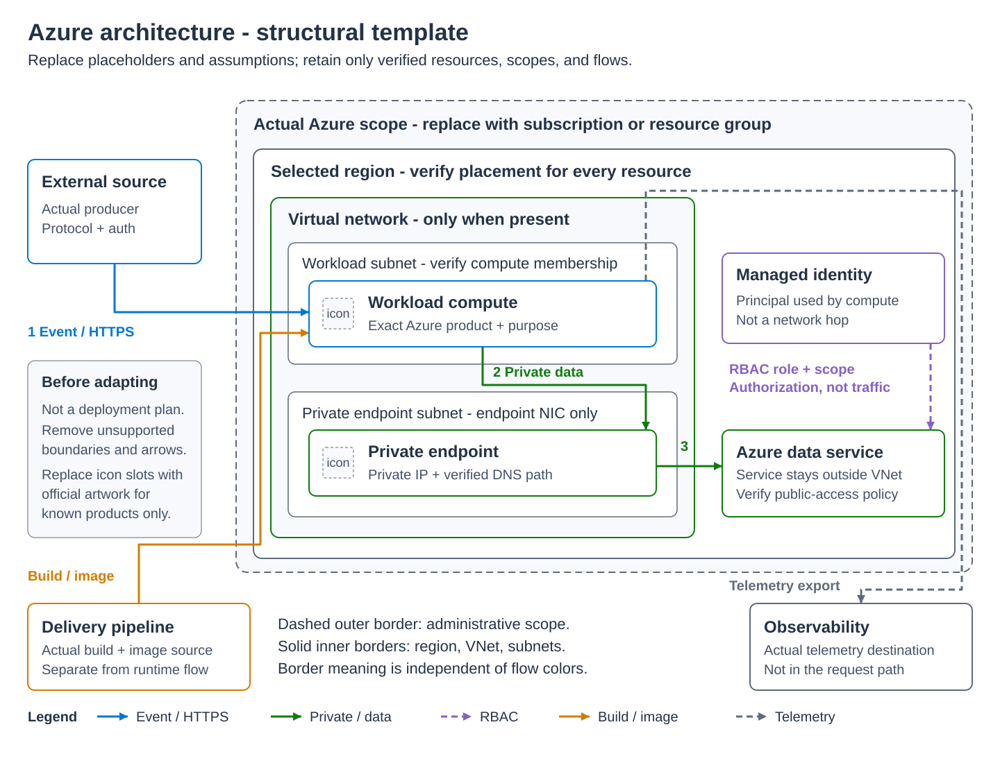

# SVG Technical Diagrams Skill

> Reusable skill for creating professional SVG diagrams to replace ASCII art, text-based diagrams, and low-quality images in documentation sites.

## When to Use

- Replace ASCII art (`┌──┐`, `│`, `└──┘`) with proper vector diagrams
- Create architecture diagrams, decision trees, flowcharts, comparison visuals
- Generate responsive, dark-mode compatible illustrations for docs sites (Docusaurus, MkDocs, Hugo, etc.)

## Install and Update

Clone the skill into your agent's skill directory, keeping `SKILL.md`, `README.md`, `references/`, `assets/`, and `scripts/` together. For GitHub Copilot CLI on Windows:

```powershell
git clone https://github.com/ricmmartins/svg-diagrams-skill.git "$HOME\.copilot\skills\svg-diagrams"
```

For other agents, use their supported skill directory. `SKILL.md` is the discoverable entry point; this README remains the original design reference.

For an existing clone, inspect local changes first:

```powershell
git -C "$HOME\.copilot\skills\svg-diagrams" status --short
# Only with no conflicting tracked or untracked files:
git -C "$HOME\.copilot\skills\svg-diagrams" pull --ff-only
```

If an older installation has a locally created `SKILL.md`, preserve it and merge its instructions before updating; do not overwrite it or discard unrelated changes. Manual installations must copy the supporting directories too, not only the entry point.

## Profiles

**Simple (default):** The palette and compact templates below remain appropriate for flowcharts, decision trees, comparisons, and small architectures. Keep the existing 700px viewBox guideline when practical.

**`azure-architecture` (opt-in):** For detailed Azure diagrams, use [the profile guidance](references/AZURE_ARCHITECTURE.md) and adapt [the self-contained structural template](assets/templates/azure-architecture.svg). It supports a larger canvas, real scope/region/VNet/subnet boundaries, numbered primary flows, and a five-category connector legend. It is an illustrative skeleton, not a deployable topology; remove unsupported boundaries and replace every placeholder.



[Open full-size template](assets/templates/azure-architecture.svg) for readable detail on narrow screens.

The visual exemplar is the public [Service Health operator diagram](https://github.com/ricmmartins/azure-service-health-slack-bot/blob/main/img/architecture-flow.svg). Reuse its visual conventions, not its workload-specific architecture.

| Azure flow | Color | Pattern |
|---|---|---|
| Event / HTTPS | `#0078d4` | Solid |
| Private network / data | `#107c10` | Solid |
| RBAC authorization | `#8661c5` | Dashed |
| Build / image | `#d47c00` | Solid |
| Telemetry | `#5f6b7a` | Dashed |

The Azure profile uses a white background and Segoe UI/Arial. Neutral surfaces and **official icon colors/gradients are exempt** from its five-color semantic palette. The template includes labeled icon slots, not Microsoft artwork. Use only the required official, unmodified icons under [Microsoft's terms](https://learn.microsoft.com/en-us/azure/architecture/icons/#icon-terms), embed them self-contained, and attribute their source; see [official icon guidance](references/AZURE_ARCHITECTURE.md#official-icons). Do not bundle the icon library.

## Validation

Every SVG needs accessible `<title>`/`<desc>` labels and meaningful Markdown alt text. Wrap long labels with `<tspan>` and **measure rendered `getBBox()` against padded card bounds**; character counts cannot establish fit. Enlarge or rearrange cards rather than hiding overflow or shrinking labels beyond readability.

Use the dependency-free [browser checker](scripts/validate-svg.js) in a test page, not inside the deliverable SVG. It checks IDs, local references, self-containment, and measured text bounds; the [validation workflow](references/AZURE_ARCHITECTURE.md#overflow-prevention-and-validation) shows XML and browser commands. Inspect screenshots at full and embedded widths, with the fallback font and the actual documentation image context. A large viewBox is not the same as readable mobile text: split dense diagrams or provide a full-size link.

## Design System

The following original design system applies to the **simple** profile.

### Color Palette (Azure-inspired, universally professional)

| Purpose | Fill | Stroke | Use for |
|---------|------|--------|---------|
| Primary containers | `#dae8fc` | `#6c8ebf` | Main groups, cloud zones |
| Success/positive | `#d5e8d4` | `#82b366` | User-owned, healthy, YES |
| Warning/secondary | `#fff2cc` | `#d6b656` | Components, attention |
| Accent/services | `#e1d5e7` | `#9673a6` | Nodes, instances, services |
| Error/negative | `#f8cecc` | `#b85450` | Errors, NO, deprecated |
| Neutral | `#f5f5f5` | `#666666` | Backgrounds, sub-groups |

### Typography

```
font-family="Segoe UI, Arial, sans-serif"
```

- Titles: `font-size="14"`, `font-weight="bold"`
- Labels: `font-size="12"`, `font-weight="bold"`
- Descriptions: `font-size="10"`, `fill="#555"`
- Small text: `font-size="8"` (inside badges/pods)

### Shape Rules

- Rounded rectangles: `rx="8"` for containers, `rx="6"` for components, `rx="4"` for small items
- Minimum padding: 15px inside containers
- Gap between sibling elements: 20-30px
- Stroke width: `2` for main borders, `1.5` for components, `1` for details

### Arrows & Connectors

```xml
<!-- Arrow marker definition (include once per SVG) -->
<defs>
  <marker id="arrow" viewBox="0 0 10 10" refX="9" refY="5" 
          markerWidth="6" markerHeight="6" orient="auto-start-reverse">
    <path d="M 0 0 L 10 5 L 0 10 z" fill="#666"/>
  </marker>
</defs>

<!-- Solid connection -->
<line x1="..." y1="..." x2="..." y2="..." stroke="#666" stroke-width="1.5" marker-end="url(#arrow)"/>

<!-- Dashed connection (managed/control) -->
<line x1="..." y1="..." x2="..." y2="..." stroke="#666" stroke-width="1.5" stroke-dasharray="4,3" marker-end="url(#arrow)"/>
```

### Decision Tree Convention

- YES paths: `stroke="#2e7d32"` (green), go left or down-left
- NO paths: `stroke="#c62828"` (red), go right or down-right
- Question boxes: blue fill (`#dae8fc`)
- Answer boxes: green fill (`#c8e6c9`)
- Intermediate questions: orange fill (`#fff3e0`)

## Templates

### Architecture Diagram

```xml
<svg xmlns="http://www.w3.org/2000/svg" viewBox="0 0 600 400" font-family="Segoe UI, Arial, sans-serif">
  <!-- Outer container (cloud/managed zone) -->
  <rect x="20" y="20" width="560" height="160" rx="12" fill="#dae8fc" stroke="#6c8ebf" stroke-width="2"/>
  <text x="300" y="48" text-anchor="middle" font-weight="bold" font-size="14" fill="#1a3a5c">Zone Title</text>

  <!-- Inner container -->
  <rect x="50" y="60" width="500" height="100" rx="8" fill="#f8f9fa" stroke="#888" stroke-width="1.5"/>
  <text x="300" y="82" text-anchor="middle" font-weight="bold" font-size="12" fill="#333">Component Group</text>

  <!-- Components inside -->
  <rect x="70" y="95" width="100" height="45" rx="6" fill="#fff2cc" stroke="#d6b656" stroke-width="1.5"/>
  <text x="120" y="122" text-anchor="middle" font-size="11" fill="#333">Component A</text>
</svg>
```

### Decision Tree / Flowchart

```xml
<svg xmlns="http://www.w3.org/2000/svg" viewBox="0 0 560 280" font-family="Segoe UI, Arial, sans-serif">
  <!-- Question node -->
  <rect x="130" y="10" width="300" height="50" rx="8" fill="#dae8fc" stroke="#6c8ebf" stroke-width="2"/>
  <text x="280" y="40" text-anchor="middle" font-size="12" fill="#1a3a5c">Your question here?</text>

  <!-- YES branch -->
  <line x1="200" y1="60" x2="120" y2="110" stroke="#2e7d32" stroke-width="2" marker-end="url(#arrow)"/>
  <text x="140" y="82" font-size="11" fill="#2e7d32" font-weight="bold">YES</text>

  <!-- Answer node -->
  <rect x="30" y="115" width="180" height="45" rx="8" fill="#c8e6c9" stroke="#2e7d32" stroke-width="2"/>
  <text x="120" y="138" text-anchor="middle" font-weight="bold" font-size="12" fill="#1b5e20">Answer</text>
  <text x="120" y="152" text-anchor="middle" font-size="10" fill="#555">Description</text>

  <!-- Arrow marker -->
  <defs>
    <marker id="arrow" viewBox="0 0 10 10" refX="9" refY="5" markerWidth="6" markerHeight="6" orient="auto-start-reverse">
      <path d="M 0 0 L 10 5 L 0 10 z" fill="#666"/>
    </marker>
  </defs>
</svg>
```

### Comparison / Side-by-Side

```xml
<svg xmlns="http://www.w3.org/2000/svg" viewBox="0 0 600 200" font-family="Segoe UI, Arial, sans-serif">
  <!-- Option A -->
  <rect x="20" y="20" width="260" height="160" rx="10" fill="#d5e8d4" stroke="#82b366" stroke-width="2"/>
  <text x="150" y="50" text-anchor="middle" font-weight="bold" font-size="14" fill="#2d5a1b">Option A</text>
  <text x="150" y="75" text-anchor="middle" font-size="11" fill="#333">Benefit 1</text>
  <text x="150" y="95" text-anchor="middle" font-size="11" fill="#333">Benefit 2</text>

  <!-- VS separator -->
  <text x="300" y="105" text-anchor="middle" font-size="16" fill="#666" font-weight="bold">vs</text>

  <!-- Option B -->
  <rect x="320" y="20" width="260" height="160" rx="10" fill="#fff2cc" stroke="#d6b656" stroke-width="2"/>
  <text x="450" y="50" text-anchor="middle" font-weight="bold" font-size="14" fill="#7a5900">Option B</text>
</svg>
```

## Integration Rules

1. **Save location**: `static/img/` (or equivalent static assets folder)
2. **Reference in Markdown**: ``
3. **Naming**: `kebab-case` — e.g., `aks-architecture.svg`, `cni-decision-tree.svg`
4. **ViewBox**: Always use `viewBox` without fixed `width`/`height` on the root `<svg>` for responsiveness
5. **No external dependencies**: Everything self-contained (no external fonts, no linked images)
6. **Dark mode**: For the simple profile, use fill colors that invert well, or add CSS media queries. The Azure profile instead keeps an explicit white background:

```xml
<style>
  @media (prefers-color-scheme: dark) {
    .bg { fill: #1e1e1e; }
    .text { fill: #e0e0e0; }
  }
</style>
```

## Prompt to Use

When you need diagrams in any project, use this instruction:

> "Replace all ASCII art and text-based diagrams with professional inline SVGs. Follow the SVG Technical Diagrams skill: use the Azure-inspired color palette, Segoe UI font, rounded rectangles, proper arrow markers, and save as responsive SVGs in static/img/. For decision trees use green=YES/red=NO convention. Keep it clean, minimal, and professional."

For a detailed Azure architecture:

> "Use the svg-diagrams azure-architecture profile for this architecture. Adapt the structural template to the verified resources and boundaries; use numbered main flows and the semantic connector legend. Keep official icons unmodified and self-contained if used. Wrap and measure labels, then inspect full-size and embedded renders."

## Anti-patterns

- ❌ Don't use fixed pixel width/height on root SVG (breaks mobile)
- ❌ Don't use external font links (breaks offline)
- ❌ Don't use complex gradients or shadows (slow rendering, bad in dark mode)
- ❌ Don't put text smaller than 8px (unreadable)
- ❌ Don't use more than 4-5 semantic colors per diagram (neutral surfaces and official icon artwork are exempt)
- ❌ Don't cram simple diagrams into a viewBox wider than 700px without need; detailed Azure diagrams may use a larger responsive viewBox, with embedded readability verified
